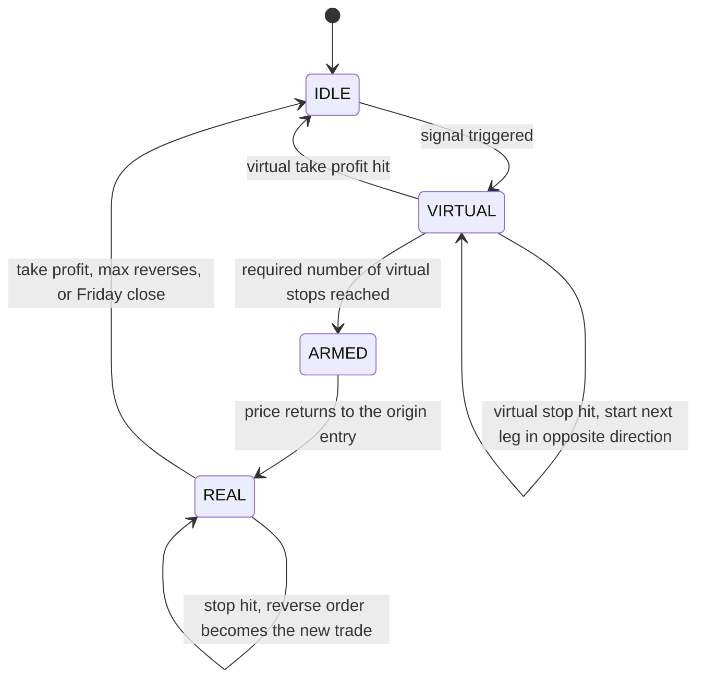
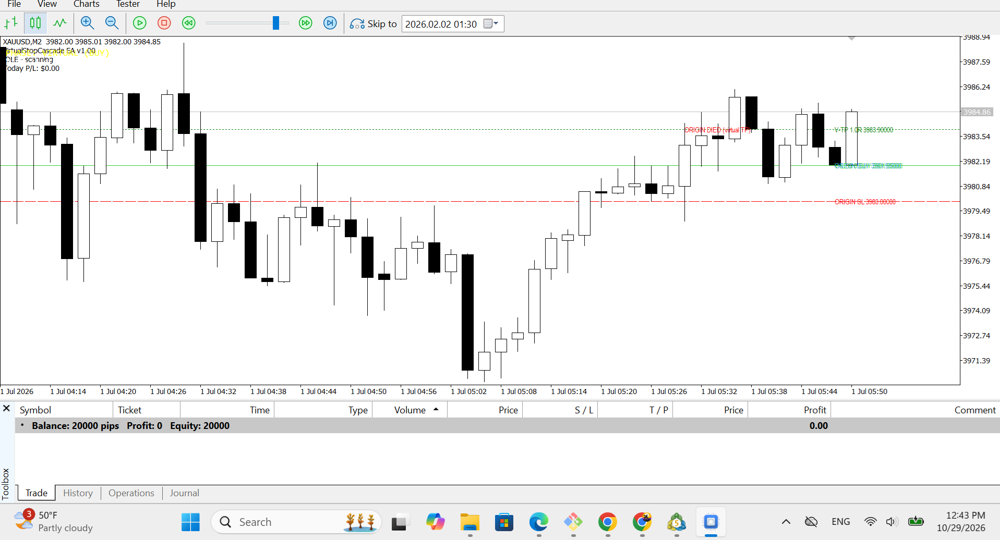
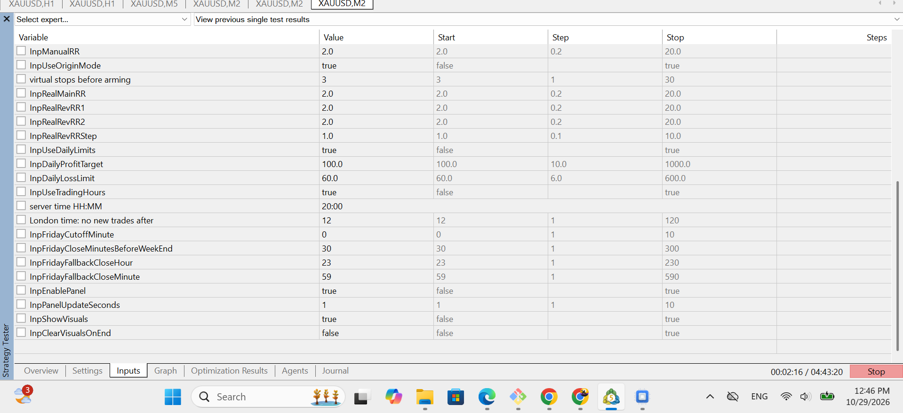

# Virtual Stop Cascade EA Framework (MQL5)

An Expert Advisor framework for MetaTrader 5. It shows how to build a trading engine that is **separate from the strategy**, so you can plug in any entry signal.

> **Note:** The entry signal in this repo is a simple demo (SMA crossover). It is only here to run the engine in the Strategy Tester. It is **not** a trading strategy and not a source of profit. My real strategy is private.

---

## What this project is

Most simple EAs open a real trade as soon as a signal appears. This EA does something different.

1. It first **trades the setup on paper** (virtual trades, no orders sent to the broker).
2. Only after a set number of virtual stop-losses, it **switches to real trades**.

The idea is to split the EA into two parts:

- **Signal part:** decides when a setup exists.
- **Engine part:** handles virtual trades, real orders, risk, time rules and the display.

Because they are separate, you can change the signal without touching the engine.

---

## How it works

The EA is a state machine with four phases:



**IDLE:** The EA waits for a new signal.

**VIRTUAL:** After a signal, the EA opens a virtual trade (the "origin"). Nothing is sent to the broker. The EA only watches price.
- If the virtual take profit is hit, the origin is dropped and the EA goes back to IDLE.
- If the virtual stop-loss is hit, the EA counts one virtual stop and starts the next virtual leg. The new leg goes in the opposite direction. Its entry is the old stop-loss, its stop-loss is the old entry, and its take profit gets bigger with each leg (2R, 3R, and so on).

**ARMED:** When the number of virtual stops reaches the limit, the EA waits for price to come back to the origin entry price.

**REAL:** When price returns, the EA opens a real trade with a risk-capped lot size. If the stop-loss is hit, a pending stop order placed at that level becomes the next trade in the opposite direction. This repeats until the take profit is hit or the maximum number of reverses is reached. The two magic numbers (A and B) alternate between legs, so each leg can be tracked.

---

## Features

- **Virtual state machine** with four phases (IDLE, VIRTUAL, ARMED, REAL)
- **Cascade system** that flips direction and increases the take-profit ratio after each stop
- **Pluggable signal layer** using a `CSignalProvider` interface. You write a class, return a direction, a trigger price and a stop reference, and the engine does the rest
- **Risk control:** lot size is calculated with `OrderCalcProfit`, so one trade never risks more than the maximum you set
- **Daily limits:** the EA stops opening new trades after a daily profit target or loss limit
- **Time rules:** no new trades after a set hour, and a Friday cutoff that uses London time (including daylight saving) and closes positions before the weekend
- **Spread filter:** no new trades when the spread is too high
- **On-chart display:** lines for entries, stops and targets, markers for virtual stops, and a status panel

---

## Screenshots

These screenshots use the demo signal.





---

## Project structure

```
mt5-origin-ea-framework/
├── README.md
├── src/
│   └── VirtualStopCascadeEA.mq5
└── docs/
    └── images/
        ├── chart.png
        └── panel.png
```

---

## How to run

1. Copy `VirtualStopCascadeEA.mq5` into your MetaTrader 5 folder: `MQL5/Experts/`
2. Open it in MetaEditor and press **Compile**.
3. In MetaTrader 5, open the **Strategy Tester**, choose the EA, pick a symbol and timeframe, and run it.
4. Watch the **Journal** and **Experts** tabs. The EA prints each step (setup, virtual stop, armed, real trade).

If you see `lot calc failed` in the log, the stop is too wide for your `InpMaxRisk`. Raise `InpMaxRisk` or lower `InpDemoStopLookback`.

---

## Main inputs

| Input | What it does |
|---|---|
| `InpMaxRisk` | Maximum risk per trade (in account currency) |
| `InpOriginStopsRequired` | How many virtual stops before the EA arms |
| `InpRealMainRR` | Take-profit ratio of the first real trade |
| `InpRealRevRR1`, `InpRealRevRR2`, `InpRealRevRRStep` | Take-profit ratios for the reverse trades |
| `InpMaxReverseCount` | Maximum number of reverse trades |
| `InpDailyProfitTarget`, `InpDailyLossLimit` | Daily limits |
| `InpNoNewTradesAfter` | No new trades after this time (server time) |
| `InpUseOriginMode` | Turn the virtual phase on or off |
| `InpDemoFastPeriod`, `InpDemoSlowPeriod` | Settings of the demo signal |

---

## Use your own signal

The engine only needs a class like this:

```cpp
class CMySignal : public CSignalProvider
{
public:
   virtual bool Evaluate(SignalResult &out)
   {
      // set out.direction (+1 buy, -1 sell),
      // out.triggerPrice and out.stopRef, then return true
      return false;
   }
};
```

Then create it in `OnInit()` instead of the demo signal:

```cpp
g_signal = new CMySignal();
```

---

## Limits of this project

- The demo signal is very simple and has no edge. Backtest results from it are only a test of the engine.
- Tested in the MetaTrader 5 Strategy Tester only. Not tested on a live account.
- The reverse cascade can lose several trades in a row. That is the nature of the method.
- Time rules depend on the broker's server time and trading session data.
- It works on one symbol at a time.

---

## Tech

- **Language:** MQL5
- **Platform:** MetaTrader 5
- **Topics:** state machines, risk management, separating signal and execution, on-chart visuals

---

## Disclaimer

For education and portfolio use only. Do not run it on a live account. This is not financial advice.

---

## License

All rights reserved. You can read the code, but you may not copy or reuse it without permission.
